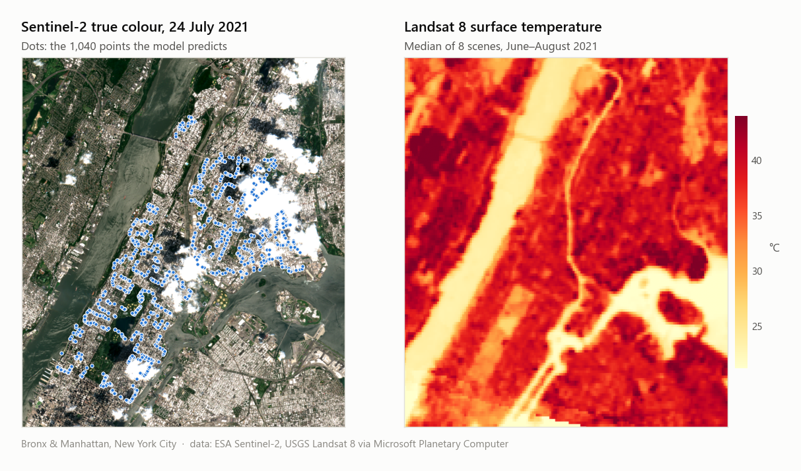
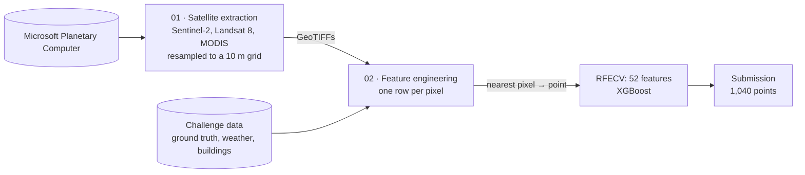

# Urban Heat Island Prediction · EY Open Science AI & Data Challenge 2025

[](https://github.com/goeyqihang/EyUrbanHeat/actions/workflows/ci.yml)

[](LICENSE)


This project predicts street-level **Urban Heat Island (UHI) intensity** in New York City (the Bronx and Manhattan). It uses multi-source satellite imagery, building footprints and weather-station data, with gradient-boosted trees (XGBoost) as the model.

<picture>
  <source media="(prefers-color-scheme: dark)" srcset="assets/study_area_dark.png">
  
</picture>

## Highlights

- **Geospatial pipeline:** downloads Sentinel-2, Landsat 8 and MODIS imagery from the Microsoft Planetary Computer STAC API and aligns every layer on one 10 m grid (2.4 million pixels).
- **Feature engineering:** 239 candidate features, covering spectral indices, single-day vs. seasonal-median change, borough-level weather, building morphology and 100 m neighbourhood (focal) means.
- **Model:** XGBoost on 52 features selected by recursive feature elimination (RFECV). The hyper-parameters come from a 5,832-configuration grid search.
- **Result:** **R² = 0.967** on a 20 % hold-out set and 5-fold cross-validation R² = 0.965, from a clean top-to-bottom run. The original competition run scored 0.968 and 0.966.
- **Engineering:** the pipeline is a tested Python package (`src/uhi`) with a command-line entry point and CI. Its spatial joins were redesigned to cut peak memory per chunk from ~13 GB to ~4 GB without changing a single output.

## The challenge

The [2025 EY Open Science AI & Data Challenge](https://challenge.ey.com) asked participants to predict a **UHI index** across the Bronx and Manhattan. The index is the air temperature at a location relative to the average over all measured locations, so values sit around 1.0.

- **Ground truth:** 11,229 street-level measurements from a temperature campaign on **24 July 2021, 15:00–16:00**.
- **Task:** predict the index at 1,040 new locations. Submissions were scored with R².

## Approach



1. **Satellite layers** ([`01_satellite_data_extraction.ipynb`](notebooks/01_satellite_data_extraction.ipynb), `uhi.satellite`): queries the STAC API for summer 2021 and builds a single-day snapshot plus a seasonal median for Sentinel-2 and Landsat 8. It adds MODIS land-surface-temperature and vegetation-index composites, reprojects everything onto the 10 m Sentinel-2 grid and writes GeoTIFFs.
2. **Features** ([`02_uhi_model_nearest.ipynb`](notebooks/02_uhi_model_nearest.ipynb), `uhi.features`): each GeoTIFF is flattened to a pixel table and enriched with the groups below. To keep memory in check, only pixels within 500 m of a training or submission point are kept (about a quarter of the grid). The spatial joins run in chunks, and the building statistics are parallelised with dask-geopandas.
3. **Mapping to points** (`uhi.features.spatial`): every training and submission point takes the features of its nearest pixel (`geopandas.sjoin_nearest`).
4. **Model** (`uhi.modeling`): RFECV with XGBoost selects the features. The tuned XGBoost model is evaluated with 5-fold cross-validation and an 80/20 hold-out split, then predicts the submission points.

| Feature group | Source | Examples |
|---|---|---|
| Spectral bands | Sentinel-2 (24 Jul 2021 and summer median), Landsat 8 (single scene and summer median) | `B01`–`B12`, `AOT`, `WVP`; `red`…`swir22`, `emis`, `trad`, `urad`, `atran`, `cdist`, `lwir11` (surface temperature) |
| Spectral indices | Sentinel-2, Landsat 8 | NDVI, NDBI, NDBIa, NDWI, NDTI, EVI, BSR, broadband albedo |
| Temporal change | single day vs. median | `<band>_diff`, `<band>_ratio` for all 30 bands |
| MODIS composites | 8-day LST / emissivity (1 km), 16-day vegetation indices (250 m) | land-surface temperature, band 31/32 emissivity, NDVI, EVI |
| Weather | NY Mesonet stations (Bronx / Manhattan), mean over 15:00–16:00 | air temperature, humidity, solar flux, wind U/V components and interactions |
| Buildings | building-footprint polygons | distance to the nearest building; count, area, perimeter, compactness, density and coverage within 500 m |
| Neighbourhood | all of the above | 100 m focal means (`buffered_<feature>`) |

## Results

| Metric | Reproducible run (`02_uhi_model_nearest.ipynb`) | Original competition run |
|---|---|---|
| Hold-out R² (20 % split) | **0.967** | 0.968 |
| 5-fold cross-validation R² (training split) | 0.965 (folds 0.961–0.968) | 0.966 (folds 0.965–0.967) |
| Training R² | 0.997 | 0.997 |
| Features used | 52 of 239 | 52 of 239 |

Both runs use the same features and model. They differ only in how the Landsat and MODIS layers were resampled: nearest neighbour now, bilinear during the competition.

The final model is `XGBRegressor(n_estimators=800, learning_rate=0.04, max_depth=15, min_child_weight=7, subsample=0.6, colsample_bytree=0.7, gamma=0, reg_alpha=0.001, reg_lambda=3.5)`.

**Selected features:**
- 20 of the 52 describe the built environment: building statistics within 500 m and their 100 m focal means.
- Most of the spectral features come from the Landsat surface-temperature product: `lwir11` and its auxiliary `urad`, `atran` and `cdist` layers, taken as single values, single-day vs. median changes and focal means.
- The MODIS composites, Sentinel-2 `B01` / `B09` and focal vegetation / water / built-up indices complete the set.

**Experiments.** [`03_uhi_model_bilinear.ipynb`](notebooks/03_uhi_model_bilinear.ipynb) repeats the pipeline with bilinear resampling, building statistics within 100 m, and inverse-distance-weighted mapping from the 5 nearest pixels. With default XGBoost parameters, RFECV scored a hold-out R² of 0.953 there, against 0.955 for the nearest-neighbour pipeline. The nearest-neighbour pipeline is the one that was tuned and used for the final submission.

## Repository structure

```
EyUrbanHeat/
├── src/uhi/                    # the pipeline as a Python package
│   ├── config.py               #   study area, file names, feature lists, model parameters
│   ├── satellite.py            #   Planetary Computer search / loading, 10 m composites
│   ├── raster.py               #   GeoTIFF writing and pixel tables
│   ├── features/
│   │   ├── spectral.py         #   spectral indices, single-day vs. median change
│   │   ├── weather.py          #   station assignment, survey-hour means, interactions
│   │   ├── buildings.py        #   footprint parsing, shape metrics, building statistics
│   │   └── spatial.py          #   pixel filtering, focal means, point mapping
│   ├── modeling.py             #   training table, RFECV, XGBoost training / evaluation
│   └── pipeline.py             #   end-to-end run: python -m uhi.pipeline
├── notebooks/
│   ├── 01_satellite_data_extraction.ipynb   # satellite layers -> GeoTIFFs
│   ├── 02_uhi_model_nearest.ipynb           # features, model, evaluation, submission (final)
│   └── 03_uhi_model_bilinear.ipynb          # archived experiment: bilinear resampling + IDW mapping
├── tests/                      # unit and regression tests (pytest)
├── data/                       # challenge files and GeoTIFFs (not tracked, see data/README.md)
├── assets/                     # figure used in this README
├── .github/workflows/ci.yml    # lint + tests on every push
├── pyproject.toml              # package metadata, pytest and ruff settings
├── requirements.txt            # pinned pip environment (Python 3.12)
├── environment.yml             # exact conda environment (Windows, 64-bit)
└── environment-crossplatform.yml   # minimal conda environment (macOS / Linux)
```

## Getting started

**1. Create the environment.** Each option also installs the `uhi` package in editable mode.

```bash
conda env create -f environment.yml
```

```bash
conda activate EyUrbanHeat
```

`environment.yml` is the exact environment used for the results, exported on Windows. On macOS or Linux, use `environment-crossplatform.yml`. Without conda, run `pip install -r requirements.txt` in a Python 3.12 virtual environment.

**2. Add the data.** Put the four challenge files in `data/raw/` as listed in [`data/README.md`](data/README.md). The satellite GeoTIFFs are not in the repository; the largest is ~160 MB, above GitHub's file-size limit. Notebook 01 regenerates them.

**3. Build the satellite layers** with `notebooks/01_satellite_data_extraction.ipynb`. It needs an internet connection and writes about 500 MB of GeoTIFFs to `data/processed/`.

**4. Train and predict**, either step by step or in one command:

- `notebooks/02_uhi_model_nearest.ipynb` shows every step with its outputs and plots and writes `outputs/submission_4.3.csv`. Select the `EyUrbanHeat` kernel in Jupyter.
- `python -m uhi.pipeline` runs the same steps end to end and writes `outputs/submission.csv` plus a metrics JSON.

Either takes about 20 minutes on a 16-thread laptop with 32 GB of RAM; the building statistics (~13 min) are the slow step. The feature selection (RFECV) and the grid search take up to several hours, so they are kept as raw cells in notebook 02 with their logged results. The selected features are listed in `uhi.config.SELECTED_FEATURES`.

**5. Run the tests**

```bash
pytest
```

## Engineering notes

- **Package and notebooks.** The notebooks are thin narratives on top of the `uhi` package, and the command-line pipeline reuses the same functions, so the notebook and the CLI cannot drift apart.
- **Memory.** The pixel table has 2.4 M rows and 164 feature columns (3.2 GB). Two spatial joins originally carried every feature column through the join. The 500 m pixel filter reached about 10 M pixel–buffer pairs (12 GB for one chunk), and the 100 m focal means about 24 M pairs per chunk (13 GB). Both now join only geometries / row indices and gather the features afterwards, which keeps each chunk to a few GB. Regression tests check that the results are identical to the original implementation.
- **Tests and CI.** The tests cover the index formulas, the weather-station window, building shape metrics, GeoTIFF I/O and model training, plus the regression tests above. GitHub Actions runs `ruff` and `pytest` and validates the notebooks on every push.

## Reproducibility notes

- Notebooks 01 and 02 were run top to bottom, as they are in this repository, on top of the `uhi` package. Notebook 03 keeps the outputs of its original competition run.
- The refactor into `src/uhi` was checked end to end against the pre-refactor notebooks: the six GeoTIFFs are pixel-identical, and the submission file and every metric (cross-validation folds, training and hold-out R²) are identical. Notebook 02 and `python -m uhi.pipeline` write byte-identical submissions.
- In the competition run, the Sentinel-2 layers were resampled with nearest neighbour but the Landsat and MODIS layers bilinearly. Notebook 01 now writes nearest-neighbour files for every layer, which explains the small differences between the two runs. The competition-time outputs are kept in the log cells of notebook 02.
- Scenes are selected by date for Sentinel-2 (2021-07-24) and by position in the Planetary Computer search results for the others. Landsat index 4 is the 2021-06-23 scene; MODIS indices 8 and 9 are the composites starting 2021-07-28. If the catalogue changes, check these indices.

## Limitations and next steps

- **Spatial validation:** the evaluation uses random splits, and neighbouring measurements are only metres apart, so the scores are optimistic. Spatially blocked cross-validation (for example, grouping points by street segment or grid cell) would give a more realistic estimate.
- **Quality masking:** cloud and fill values are not masked with the QA layers before compositing (e.g. Landsat `qa_pixel`, MODIS quality flags). Masking them should reduce noise in the thermal and vegetation features.
- **Temporal alignment:** the Landsat snapshot and the MODIS composites were not taken on the survey day. Pairing each product with the acquisition closest to 24 July 2021 should strengthen the "conditions on the day" features.

## Acknowledgements

- Problem statement and ground-truth, weather and building data: the [EY Open Science AI & Data Challenge](https://challenge.ey.com).
- Satellite imagery: ESA Copernicus Sentinel-2, USGS Landsat 8 and NASA MODIS, accessed through the [Microsoft Planetary Computer](https://planetarycomputer.microsoft.com/).
- Weather observations: the New York State Mesonet.
